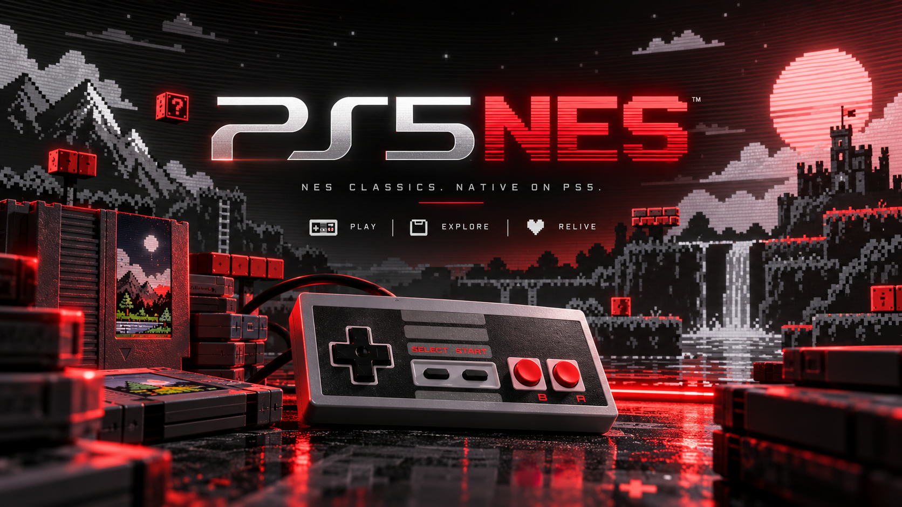
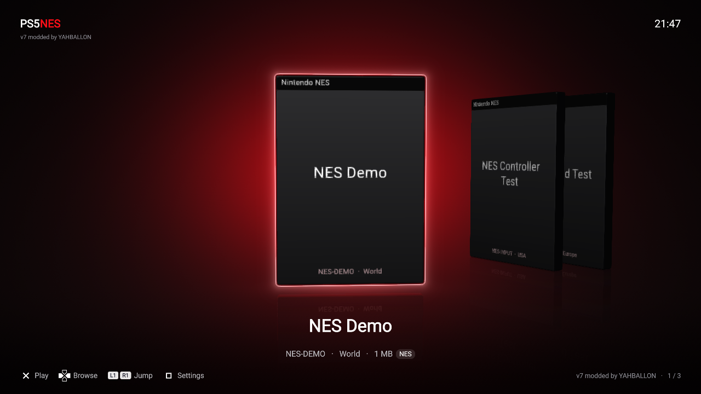

# PS5NES is a passion project, not a piracy project.

  

PS5NES is a native PS5 homebrew NES emulator using **FCEUmm**. It keeps the PS5SX2 shelf, animated game cases, cover glow, reflections, menu sounds and settings panel, with a NES backend.
**NES games on your PS5, with the original PS5SX2 cover-flow interface.**

**v1.0.0.9 — by YAHBALLON** · **App ID: PPSA99204**

## Features

A red, charcoal and gray NES-inspired theme with the supplied controller-style launcher logo.

- Play **iNES / NES 2.0** ROMs and **UNIF** images.
- Load games from internal storage, USB or an **NFSv3 share**.
- Play ZIP archives containing **one NES ROM**, decompressed directly into RAM.
- Automatic NES box-art downloads and custom local covers.
- A cached game library for fast repeat launches, with a loading screen for discovery.
- Battery-backed saves and **one save-state slot per ROM**.
- Configurable NES buttons and save/load/menu shortcuts, globally or per game.
- A controller-operated NFS URL keyboard and a QR web settings page.
- Bounded cover streaming for large libraries.
- No PS2 BIOS required.

## Interface preview

Host-rendered preview with demo titles. The app keeps the original PS5SX2 shelf layout.

## Install

1. Download the **application ZIP** from the release assets and extract it.
2. Copy the complete **PPSA99204** folder to:

   ~~~text
   /data/homebrew/PPSA99204/
   ~~~

3. Launch it with your compatible PS5 homebrew launcher.

Keep every packaged file, including sce_module/libc.prx, lapy.elf, lapy-manifest.json and sce_sys/icon0.png. Your existing games, saves and settings live separately in /data/PS5NES/.

For an update, replace the application files and restart the app. Refresh the launcher if it still shows the old icon.

The filesystem helper is restricted to this app's title ID. If filesystem access is unavailable, it needs the local ELF loader on port **9021**. A normal retail PS5 cannot run this homebrew app.

## Add games

### Internal storage

~~~text
/data/PS5NES/games/
/data/homebrew/PS5NES/games/
/data/homebrew/PS5NES/roms/
/data/homebrew/PPSA99204/roms/
~~~

### USB

~~~text
/mnt/usb0/homebrew/PS5NES/games/
~~~

USB0 through USB7 are supported. These alternative folders are also scanned:

~~~text
/mnt/usb0/homebrew/PS5NES/roms/
/mnt/usb0/PS5NES/games/
/mnt/usb0/NES/
~~~

Subfolders are scanned up to five levels deep. Internal ROM detection also handles mounts that deny file metadata.

### NFS

Open **Square → R1 / All games → Settings → Network → NFS URL**.

Example:

~~~text
nfs://192.168.1.10/NES
~~~

Save the URL and restart PS5NES. The same configuration can be entered in /data/PS5NES/nfs.txt, one URL per line, with up to four shares.

The app connects directly to the server. ROMs are read into RAM when launched; no PS5 kernel mount is required.

### ZIP support

Use **one .nes, .unf or .unif image per ZIP**. Stored and Deflate compression are supported.

- Maximum ROM size: **32 MiB**
- Maximum ZIP/file size: **64 MiB**
- Encrypted, multi-ROM and ZIP64 archives are not supported.
- A ZIP containing an entire ROM collection must be unpacked into individual ROMs or individual game ZIPs on your server.

## Controls

### Game shelf

| Action | Default |
| --- | --- |
| Browse games | D-pad / left stick, left and right |
| Start game | Cross |
| Open settings | Square |
| This game / All games | L1 / R1 in settings |
| Settings / Controls tab | L2 / R2 in settings |

### In game

| NES action | Default controller button |
| --- | --- |
| A | Cross |
| B | Circle |
| Start | Options |
| Select | Touchpad click or Create |
| Directions | D-pad; left stick also enabled by default |

| Emulator shortcut | Default combination |
| --- | --- |
| Save state | L3 + R3 + D-pad Up |
| Load state | L3 + R3 + D-pad Down |
| Return to shelf | L1 + R1 + touchpad click |

### Customize your buttons

Open **Square → R2 / Controls** to view and edit assignments.

- Choose **All games** for global defaults or **This game** for an override.
- Left/right or Cross cycles an assignment.
- Each emulator shortcut has up to three button fields. **None** skips a field; all None disables that shortcut.
- Settings save immediately and apply when the next game is started.
- Save/load shortcuts trigger once per press and consume their bound game inputs.
- Holding **L1 + R1 + touchpad click for two seconds** remains an emergency route back to the shelf.

Saving a new state overwrites that ROM's previous state slot. Battery saves are written every five seconds and when returning to the menu.

## Library cache

The first successful scan creates a local index. Internal and USB folders are scanned at every startup; later starts reuse the NFS index without rescanning the share.

After adding, removing or renaming games, choose:

**Square → R1 / All games → Settings → Network → Rescan game library**

Then restart PS5NES. Changing the NFS URL selects a separate cache automatically.

The loading bar indicates activity while the total directory size is unknown. Live game and entry counts are shown.

## Covers

Automatic box art uses the bundled 742-entry NES repository index, with [Libretro NES thumbnails](https://github.com/libretro-thumbnails/Nintendo_-_Nintendo_Entertainment_System) as a fallback. Matching handles title punctuation and region tags; No-Intro-style filenames work best. Press **R2 on the shelf** to refresh the selected cover. The previous cover is retained if downloading fails.

For your own cover:

~~~text
/data/PS5NES/covers/Game Name (USA).png
~~~

Match the game filename without its extension. PNG and JPEG are supported.

Only nearby artwork is kept live; downloaded covers remain cached on disk.

## App data and logs

| Content | Location |
| --- | --- |
| Games | /data/PS5NES/games/ |
| Saves and states | /data/PS5NES/saves/ |
| Global settings | /data/PS5NES/gs.ini |
| Per-game settings | /data/PS5NES/settings/ |
| Custom covers | /data/PS5NES/covers/ |
| Library, cover and shader caches | /data/PS5NES/cache/ |
| Boot log | /data/PS5NES/logs/boot.log |
| Cover download errors | /data/PS5NES/logs/cover-download.log |
| NFS URLs | /data/PS5NES/nfs.txt |

If /data is unavailable, the app uses /download0/PS5NES as a fallback data folder. The QR settings page listens on **port 8844** and can provide logs.

## Build from source

See [BUILDING.md](BUILDING.md) for the tested dependency layout, pinned versions and build command.

The active app is in **nes/src/** and uses **ps5/frontend/** directly. The inherited PCSX2 source is retained as the original project scaffold; the NES build does not compile its PS2 emulator core.

## Current limits and testing

- One active player in the current app integration.
- FDS and Zapper/light-gun input are not exposed.
- General firmware compatibility has not been established.
- The NES/menu baseline and v5 memory fix were reported working on a user's PS5. The controller bindings passed host tests, and the v7 theme was rendered and visually checked; broader console testing is still needed.
- No copyrighted ROMs, game images, BIOS files or console keys are included.

## Credits and license

- **YAHBALLON** — project customization and supplied logo.
- **Spyros and PCSX2 contributors** — original PS5SX2 interface and project scaffold.
- [FCEUmm / Libretro](https://github.com/libretro/libretro-fceumm) — NES emulation.
- [mihawk-99 / PS5_Vulkan](https://github.com/mihawk-99/PS5_Vulkan) — native Vulkan driver and runtime work.
- [BlackBearReloaded / ps5-native-app-boilerplate](https://github.com/blackbearreloaded/ps5-native-app-boilerplate) — native startup, packaging and elevation client.
- [Lapy filesystem helper](https://github.com/mpereiraesaa/PS5-Lapy-JB-Daemon) — restricted filesystem helper.
- Libnfs, libcurl, OpenSSL, zlib, zstd, libpsl and the bundled font/library authors.

PS5NES integration code is GPL-3.0-or-later. Upstream components retain their own licenses and notices. See [LICENSE](LICENSE), [THIRD_PARTY_NOTICES.md](THIRD_PARTY_NOTICES.md) and the included license files.

## Earlier library and cover improvements (AI-assisted)

Local/USB directories are freshly scanned even with a warm NFS cache. Offline
IPv4 NAS detection is bounded and local games are retained. Valid folders include
/data/PS5NES/games and /mnt/usb0/homebrew/PS5NES/games (USB0 through USB7).
Empty-library hints are shown only when no game is selected. R2 on the shelf
refreshes the selected cover, preserving the previous image on failure.
The 742-file NES repository index adds normalized title/region matching with
libretro fallback and retries old failed cover lookups. FCEUmm and the NES theme
are retained. Native build and host tests passed;
latest changes still need PS5 testing.

## v1.0.0.9 by YAHBALLON (AI-assisted)

Internal ROM discovery no longer requires successful path metadata for every file. Known directory-entry types and opened descriptors are used; header probing and bounded stream reads support mounts that also deny descriptor metadata. The library cache can be read without path metadata. Added internal aliases `/data/homebrew/PS5NES/games/`, `/data/homebrew/PS5NES/roms/` and `/data/homebrew/PPSA99204/roms/`. ROM source paths are displayed beneath the selected game title. Failed directory access and scan counts are reported in boot.log. USB and cached NFS regressions passed; internal detection under simulated metadata denial and the actual Vulkan path display were verified. Console retest remains required.
